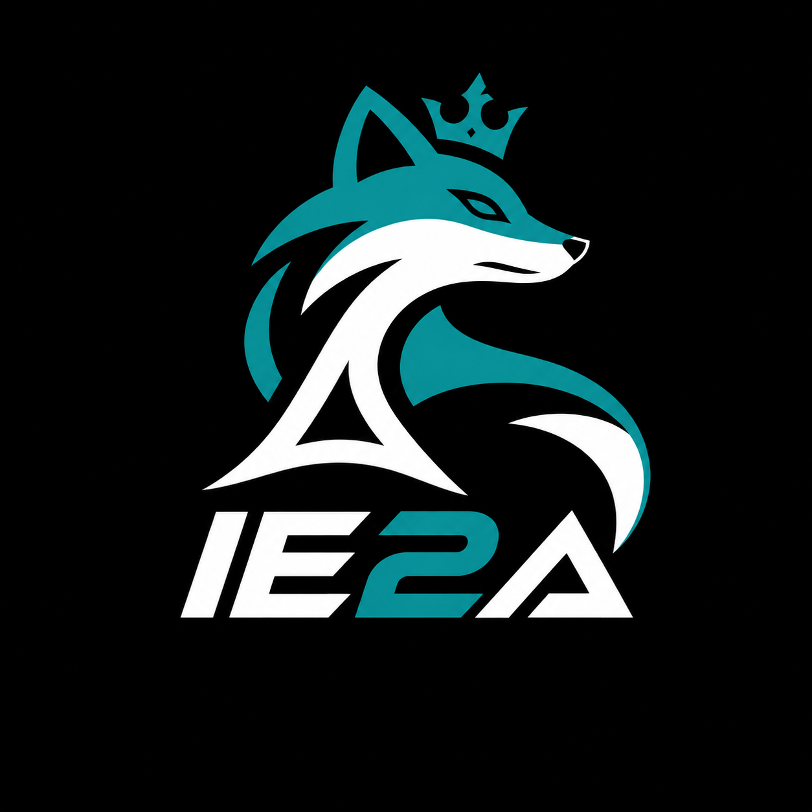

# TCC_Forja-IE2A

## Nome da empresa e do sistema: 
 - IE2A

## Logo do projeto:
 

## Descrição do sistema:
 
 ### O sistema terá:
 - Página login.
 - Página perfil.
 - Página inicial.
 - Página de catálogo.
 - Página minha biblioteca.
 - Página adicionar jogo.

## Objetivo e problema que pretende resolver:
 - O objetivo do IE2A é juntar vários jogos de várias empresas em um único lugar, resolvendo o problema de ter que ir em vários sites apenas para obter os jogos desejados trazendo praticidade e otimização de tempo para o usuário

## Principais funcionalidades:
 - Compilação de jogos

## Tecnologias utilizadas:
 - Linguagem CSS e TypeScript

## Integrantes do grupo:
 - Ismael
 - Enzo
 - Antony
 - Alfredo
## Instruções básicas para executar o projeto:
 - 
